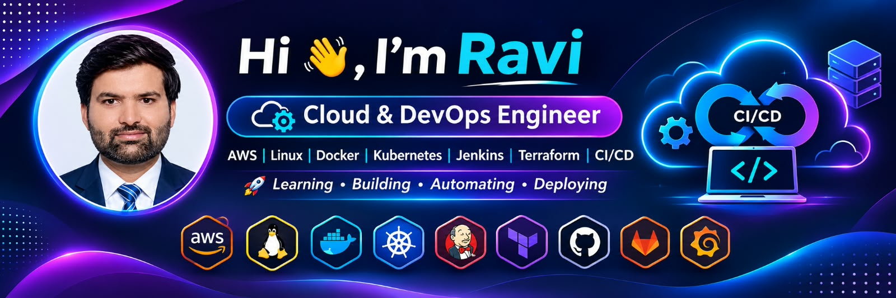

---

# 👋 Hi, I'm Ravi

### 🚀 Cloud & DevOps Engineer | AWS | Linux | Docker | Kubernetes | Jenkins | Terraform

**Learning • Building • Automating • Deploying**

---

## 👨‍💻 About Me

I am Ravi, an aspiring Cloud & DevOps Engineer passionate about Cloud Computing, Infrastructure Automation, CI/CD and modern DevOps technologies.

I enjoy learning new technologies, implementing hands-on projects and solving real-world technical challenges.

- ☁️ Learning AWS Cloud Services and Architecture
- 🐧 Practicing Linux Administration
- 🔧 Working with Git, GitHub and GitLab
- ⚙️ Learning Jenkins and CI/CD Pipelines
- 🐳 Exploring Docker and Kubernetes
- 🏗️ Practicing Terraform and Infrastructure as Code
- 📊 Professional background in Python and Data Analytics
- 🎯 Focused on building reliable and scalable cloud infrastructure
- 🌏 Interested in international Cloud & DevOps opportunities

---

## 🛠️ Technical Skills

### ☁️ Cloud Computing

### 🐧 Operating Systems

### 🔧 Version Control

### ⚙️ DevOps Tools

### 📊 Programming & Analytics

---

## ☁️ AWS Cloud Knowledge

- Amazon EC2
- Amazon S3
- AWS IAM
- Amazon RDS
- AWS Lambda
- Amazon CloudFront
- Amazon SNS
- AWS Budgets
- S3 Event Notifications
- Static Website Hosting
- Terraform-based Infrastructure
- Cloud Architecture Fundamentals

---

## 🚀 DevOps Learning Journey

| Day | Topics |
|---|---|
| Day 01 | Git & GitHub Fundamentals |
| Day 02 | Git Commands and Branching |
| Day 03 | GitHub Features and Jenkins Installation |
| Day 04 | Linux Basics and Commands |
| Day 05 | AWS RDS and MySQL |
| Day 06 | AWS S3, CloudFront and Terraform |
| Day 07 | Jenkins Agents and CI/CD Pipelines |
| Day 08 | GitLab and Portfolio Development |

**Current Focus:** AWS Cloud, Jenkins, Docker, Kubernetes, Terraform and CI/CD Automation.

---

## 🚀 Featured Projects

### 1. RU ZARA AI
Python-based Voice Assistant project with automation features.

### 2. Motorola Mobile Sales Dashboard
Interactive Power BI dashboard using Power Query and DAX.

### 3. CodeAlpha Data Analytics Projects
- Exploratory Data Analysis
- Data Visualization
- Web Scraping
- Data Cleaning

### 4. AWS S3 and CloudFront Project
Static website deployment using AWS S3, CloudFront and Terraform.

### 5. Jenkins CI/CD Practice
Hands-on practice with Jenkins pipelines, agents and automation.

---

## 🏆 Professional Certifications

### ☁️ 1. AWS Cloud Solutions Architect

**Issuer:** Amazon Web Services (AWS) – Coursera

**Completion Date:** October 16, 2026

**Professional Certificate – 4 Courses**

Courses completed:
- AWS Cloud Technical Essentials
- Architecting Solutions on AWS
- Building Data Lakes on AWS
- Exam Prep: AWS Certified Solutions Architect – Associate

[Verify AWS Professional Certificate](https://coursera.org/verify/professional-cert/YPHWI969W5SF)

### 📊 2. IBM Data Analyst

**Issuer:** IBM – Coursera

**Completion Date:** September 5, 2026

**Professional Certificate – 11 Courses**

Courses completed:
- Introduction to Data Analytics
- Excel Basics for Data Analysis
- Data Visualization and Dashboards with Excel and Cognos
- Python for Data Science, AI & Development
- Python Project for Data Science
- Databases and SQL for Data Science with Python
- Data Analysis with Python
- Data Visualization with Python
- IBM Data Analyst Capstone Project
- Generative AI: Enhance your Data Analytics Career
- Data Analyst Career Guide and Interview Preparation

[Verify IBM Professional Certificate](https://coursera.org/verify/professional-cert/0VWTUB49SLUS)

### 🚀 3. Cloud & DevOps Training

- CloudDevOpsHub – Batch 45
- Git and GitHub
- GitLab
- Jenkins and CI/CD
- Linux Administration
- AWS Cloud Computing
- Docker and Kubernetes Fundamentals
- Terraform and Infrastructure as Code

---

## 📊 GitHub Statistics

---

## 🎯 Career Objective

My goal is to become a skilled Cloud & DevOps Engineer with practical expertise in:

- Cloud Infrastructure Management
- CI/CD Pipeline Automation
- Containerization and Orchestration
- Infrastructure as Code
- Monitoring and Logging
- Cloud Security and Reliability

I believe in continuous learning, hands-on implementation and solving real-world technical problems.

---

## 🤝 Connect With Me

- GitHub: https://github.com/ravidangi41
- LinkedIn: Add your LinkedIn profile URL here

---

## 💡 My Learning Philosophy

**LEARN EVERY DAY | BUILD REAL PROJECTS | AUTOMATE EVERYTHING**

Continuous Learning + Hands-on Practice = Growth 🚀

⭐ Thank you for visiting my GitHub Profile!
